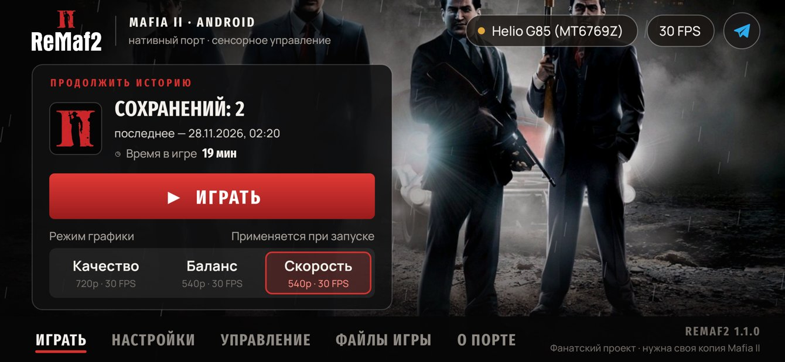
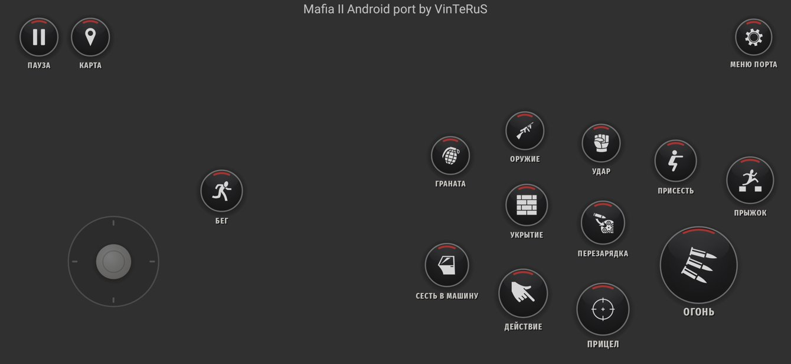
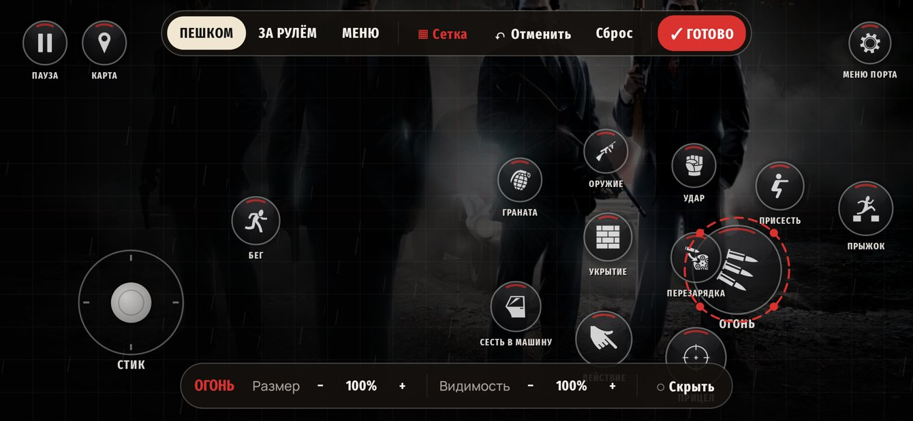
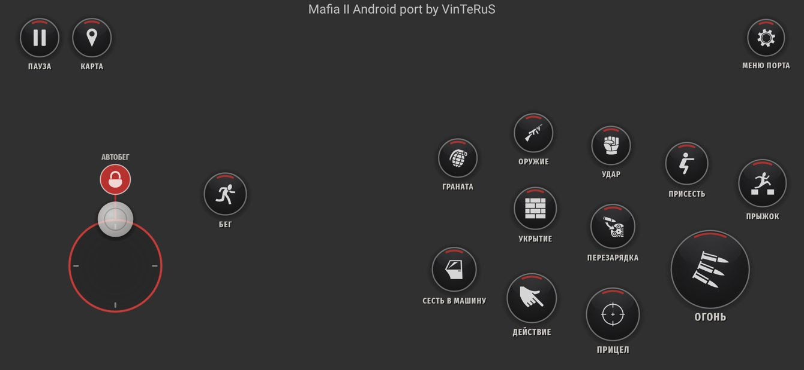

# ReMaf2 (Mafia II Droid)

Лаунчер, сенсорное управление, редактор раскладки и профили графики для Android-порта
**Mafia II** от **VinTeRuS** (`com.mafia2re.game`, patreon.com/cw/VinTeRuS).

Игра в порте — статическая рекомпиляция `mafia2.exe` + PhysX/APEX под ARM64 (`libmain.so`),
D3D9 → Vulkan через DXVK, Turnip для Adreno. Это нативный код, а не эмуляция. Этот каталог
не трогает `libmain.so` и `classes.dex` порта: он добавляет `classes2.dex` со своим слоем
и пересобирает манифест/ресурсы.



## Что внутри
- **Лаунчер** (`LauncherActivity`, только русский): выбрал папку → игра стартует. Вкладки
  «Играть / Настройки / Управление / Файлы игры / О порте», режимы «Качество / Баланс /
  Скорость», арты Mafia II на фоне (`assets/img`, смена по вкладкам), логотип и иконка ReMaf2,
  Telegram @rommy_apps, «Отправить лог». Шрифты Manrope + Fira Sans Extra Condensed (OFL).
- **Профиль устройства** (`DeviceProfile`): чип, GPU (GL_RENDERER), RAM, частота, ARMv8.2
  (LSE + RCpc), Vulkan → класс телефона → пресет. Helio G85/Mali-G52 по умолчанию: 540p,
  низкие текстуры, 30 FPS.
- **Управление** (`ControlsOverlay`, `ControlLayout`, `Glyphs`): стик как в шутерах (52dp;
  вперёд до упора — бег, дотянуть до замка — автобег до следующего касания), иконки
  game-icons.net (CC BY 3.0, `assets/ICONS-CREDITS.txt`), обзор свайпом и с кнопки огня, педали в машине, гироскоп, режим меню (абсолютные
  клики), прятание при геймпаде, счётчик FPS. Заменяет `TouchControls` порта внутри
  `M2GameActivity` (наследник `GameActivity`: библиотеки, окружение и титр автора остаются).
- **Редактор раскладки** (`EditorChrome`): три набора (пешком / за рулём / меню),
  перетаскивание, щипок для размера, ± размер и прозрачность, скрытие, сетка, отмена, сброс.
- **Меню порта** (шестерёнка в игре): лимит FPS на лету, настройки сенсора, редактор, выход.





## Сборка
```bash
cp "MAFIA 2 BY ROMMY.apk" mafia2/orig/m2.apk      # оригинальный APK порта (git-ignored)
python3 mafia2/build_m2.py                          # -> mafia2/output/ReMaf2 <ver>.apk
cd mafia2/tests/robo && gradle testDebugUnitTest    # тесты + скриншоты в mafia2/build/shots
```
Нужны Android SDK (build-tools 36, platform 36), JDK 17+, openssl. Ключи подписи —
`mafia2/.signing_keys/` (создаются при первой сборке, в git не попадают; для обновлений
поверх установленной версии нужен тот же ключ). Версия — `VERSION_NAME/VERSION_CODE` в
`build_m2.py`.

## Протокол с игрой
- Клавиши: Android key codes → `SDLActivity.onNativeKeyDown/Up` (SDL переводит в PC-клавиши).
- Мышь: `SDLActivity.onNativeMouse(state, action 0/1/2, x, y, relative)`.
- `TouchControls.nativeGameState()`: бит 8 — состояние известно, 1 — игрок управляет,
  2 — в машине, 4 — ролик. `nativeSetFpsLimit`, `nativeFps/FrameMs/MemoryMiB`.
- Настройки движка: `<externalFilesDir>/mafia2re.ini` (`render_height`, `texture_skip_mips`,
  `game_detail`, `fps_limit`, `battery_saver`, `vulkan_driver = system|turnip`, `game_voice`,
  `game_lang`). Переменные: `MAFIA2RE_GAME`, `MAFIA2RE_CUSTOM_DRIVER`.

## Совместимость
- CPU: нужны ARMv8.2-ядра (LSE + RCpc): Cortex-A55/A75 и новее — Helio G85+, Dimensity,
  Snapdragon 665+, Exynos 850+. В `libmain.so` ~1,04 млн `LDAPR` и 132 LSE-атомика inline;
  для Cortex-A53 (ARMv8.0) нужен отдельный `libmain_v80.so` (LDAPR→LDAR + трамплины LSE) —
  пока не сделан, лаунчер честно предупреждает.
- GPU: Vulkan 1.1. Adreno — Turnip/системный (авто), Mali/Xclipse/PowerVR — системный.

## Ресурсы
- `tools/make_glyph_drawables.py <game-icons repo> res assets/ICONS-CREDITS.txt` — иконки кнопок
  (VectorDrawable). `m2_ic_crouch.xml` (иконка автора) и `m2_ic_telegram.xml` нарисованы вручную.
- `tools/make_logo_assets.py <logo.jpg> assets/img` — прозрачные логотипы ReMaf2.
- `tools/make_icons.py res assets/img/logo_full.png` — иконка приложения.
- Adreno 8xx: по умолчанию системный драйвер Vulkan (Turnip на этих GPU давал полосы/мусор).
